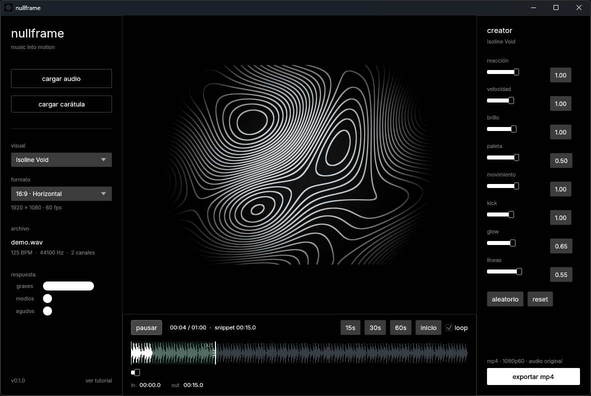
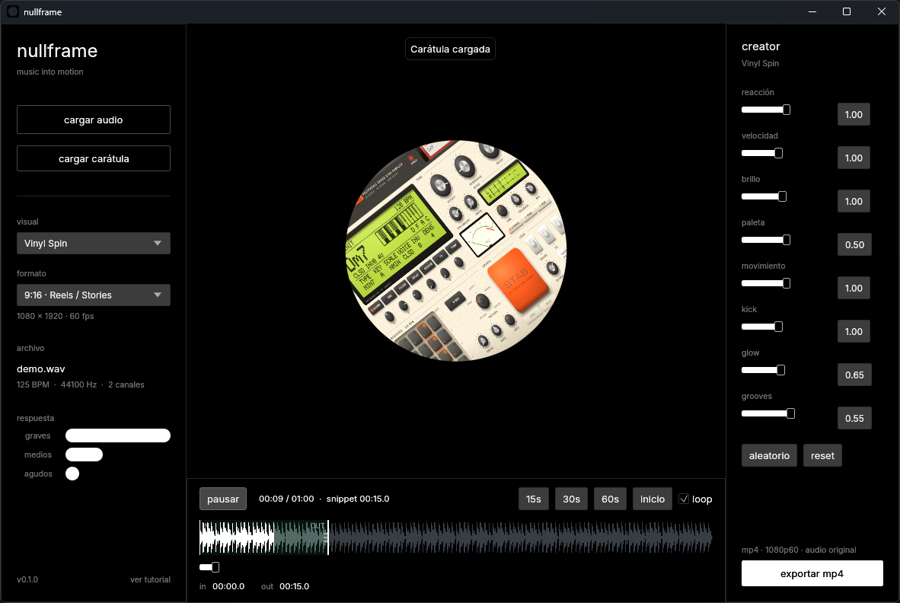
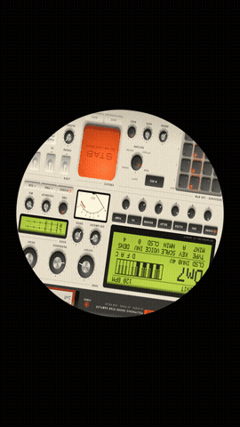

# Nullframe

Nullframe convierte archivos de audio en visuales generativas sincronizadas.



| Vinyl Spin en 9:16, con carátula | Exportación real (MP4 1080×1920, 60 fps) |
| --- | --- |
|  |  |

Las capturas se tomaron con un loop de prueba generado con FFmpeg (bombo a 124 BPM, hi-hats y bajo); Nullframe lo detectó como 125 BPM. La carátula es una captura de [STABR](https://github.com/franbachiller/stabr), otro proyecto mío. El GIF es un recorte del MP4 que exportó la app.

## Estado actual

El prototipo 0.1 permite:

- Cargar archivos WAV, MP3, FLAC y OGG.
- Reproducir, pausar y desplazarse por el track.
- Analizar graves, medios, agudos, volumen y transitorios en tiempo real.
- Elegir entre visuales generativos de estética oscura y reproducción de vinilo:
  `Isoline Void` y `Vinyl Spin`.
- Cargar carátulas personalizadas (artwork de vinilo en PNG, JPG, WEBP) para hacerlas girar en 3D sobre el plato.
- Sincronizar líneas de contorno fluidas y surcos plásticos con reflejos de luz
  al ritmo de graves, medios, agudos y transitorios.
- Ajustar cada visual desde Creator Mode: reacción, velocidad, brillo,
  paleta, movimiento, kick, glow y un parámetro específico por visual.
- Elegir formato de canvas (16:9, 9:16, 1:1 y 4:5) con previsualización real.
- Seleccionar un snippet con puntos in/out, presets de 15/30/60 s y loop.
- Exportar el snippet a MP4 1080p60 (H.264 + AAC) con sincronización
  frame-perfect, conservando el volumen original del track sin normalizar.
- Recorrido guiado la primera vez que se abre la app (se puede repetir desde
  *ver tutorial*, abajo a la izquierda).

## Ejecutar

Requiere Rust 1.92 o posterior.

```sh
cargo run --release
```

En el entorno Windows actual, que utiliza MinGW (w64devkit):

```bat
set PATH=%PATH%;D:\mingw\w64devkit\bin
cargo +stable-x86_64-pc-windows-gnu run --release
```

## Exportación de vídeo

La exportación usa FFmpeg. Nullframe busca el ejecutable en este orden:
junto al binario de la app, en la carpeta `tools/` y, por último, en el PATH
del sistema. Coloca `ffmpeg.exe` en `tools/` para habilitar *exportar mp4*.

Cada frame se renderiza en la GPU, se convierte allí a YUV 4:2:0 BT.709 y se
envía a FFmpeg en un pipeline de 3 frames en vuelo. El codificador se elige
solo: NVENC (NVIDIA), AMF (AMD) o Quick Sync (Intel) si la máquina los tiene,
y x264 en CPU como respaldo. Si el codificador de la GPU falla, se reintenta
en CPU automáticamente.

## Instalador

```bat
powershell -ExecutionPolicy Bypass -File tools\build_installer.ps1
```

Genera `dist\Nullframe-Setup-<versión>.exe`, un único ejecutable con la app y
FFmpeg comprimidos. Instala por usuario, sin permisos de administrador, en
`%LOCALAPPDATA%\Programs\Nullframe`, con acceso directo en el menú Inicio
(y opcionalmente en el escritorio). Se desinstala desde *Configuración →
Aplicaciones*. Para automatizar: `--silent [--dir <carpeta>]` y
`uninstall.exe --uninstall --silent`.

El icono se genera con `python tools/make_icon.py` (requiere Pillow).

## Arquitectura

| Módulo | Responsabilidad |
| --- | --- |
| `audio.rs` | Decodificación y reproducción (rodio), forma de onda con picos de todos los canales y detección de BPM |
| `analysis.rs` | FFT (rustfft) por ventana: energía de graves, medios y agudos, volumen y transitorios, con suavizado |
| `gpu.rs` + `shaders/*.wgsl` | Pipelines de wgpu, uniforms por frame y texturas de carátula; cada visual es un shader de fragmentos |
| `creator.rs` | Controles del Creator Mode, rangos válidos y aleatorización acotada |
| `export.rs` | Render offscreen frame a frame, conversión RGB → YUV 4:2:0 BT.709 en GPU, pipeline de 3 frames en vuelo hacia FFmpeg y detección del codificador (NVENC, AMF, Quick Sync o x264) |
| `app.rs` / `tutorial.rs` | Interfaz con egui/eframe y recorrido guiado |
| `installer/` | Instalador propio en Rust: payload comprimido, instalación por usuario y desinstalación |

El análisis y el render usan el mismo reloj de audio, tanto en la vista previa como en la exportación. Por eso el video exportado queda sincronizado frame a frame con el sonido.

## Tests

```bat
cargo +stable-x86_64-pc-windows-gnu test
:: requieren GPU:
cargo +stable-x86_64-pc-windows-gnu test --release -- --ignored
```

Resultado del 28/10/2026 (toolchain MSVC, Rust 1.96): **13 tests** sin GPU en verde y los **3 tests de GPU** en verde (conversión YUV contra la referencia, frame offscreen no negro y benchmark de exportación).

| Benchmark de exportación (10 s, 600 frames, x264 en CPU) | Tiempo | Velocidad |
| --- | --- | --- |
| 16:9 · Isoline Void | 6,81 s | 88 fps (1,47× tiempo real) |
| 9:16 · Vinyl Spin | 6,12 s | 98 fps (1,63× tiempo real) |

Con un codificador de GPU (NVENC, AMF o Quick Sync) la exportación es más rápida.
